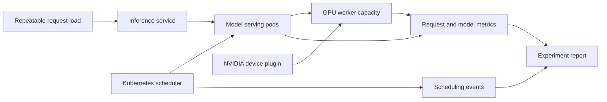

# GPU Inference Scheduling Lab

A portfolio project for studying how Kubernetes schedules and operates GPU inference workloads under contention.

The deliverable is a reproducible cluster experiment with observable scheduling decisions, workload measurements, and an explanation of tradeoffs. A local model demo alone does not meet that goal.

## Status

Planning scaffold. No cluster, GPU workload, benchmark, or performance result has been delivered yet.

## Questions to investigate

- What happens when two workloads request an exclusive GPU and only one is available?
- How do node labels, taints, tolerations, resource requests, and quotas constrain placement?
- How do workload priority and pod preemption change placement and user-visible inference latency?
- What changes when serving replicas share a GPU through supported time slicing, compared with exclusive allocation?
- How do model loading, memory pressure, request queues, and restarts affect throughput and tail latency?

Start with the standard scheduler and NVIDIA device plugin before deciding whether a custom scheduler is justified. Kubernetes pod placement, inference request scheduling, and distributed model execution are distinct layers.

## Intended architecture

## Delivery stages

1. [Define hardware access and experiment boundaries](docs/experiment-plan.md).
2. Prove exclusive GPU allocation and observable resource contention on a real GPU worker.
3. Compare placement controls and pod priority with a fixed workload.
4. Compare supported sharing with exclusive allocation, then investigate replica scaling if hardware permits.
5. Publish commands, measured results, limitations, teardown, and a short demonstration.

One GPU worker can prove scheduling contention. It cannot establish multi-GPU scaling or distributed inference performance. Simulated resources may help development but will be labeled as simulation.

## Scope and infrastructure

This repository is independent of other application projects. The target is cluster scheduling, inference operations, and evidence, rather than model training or application features.

Hardware/provider selection is pending. Google Cloud's unupgraded free trial does not allow adding GPUs to VM instances; see the [trial restrictions](https://docs.cloud.google.com/free/docs/free-cloud-features). A hosted model API also does not expose the provider's GPU scheduler. Design and simulation can proceed while access to a real GPU worker is resolved.

Do not enable paid billing or provision resources from this scaffold. Any future provisioned environment needs an explicit resource limit, experiment window, cost estimate, teardown procedure, and owner approval of spending.

## Evidence standard

Record versions, hardware, workload settings, expected scheduling behavior, actual events, GPU-use evidence, cold/warm runs, latency distributions, throughput, errors, and limitations. Use a model that fits the selected hardware. Commit no credentials, account exports, model weights, or private recordings.
