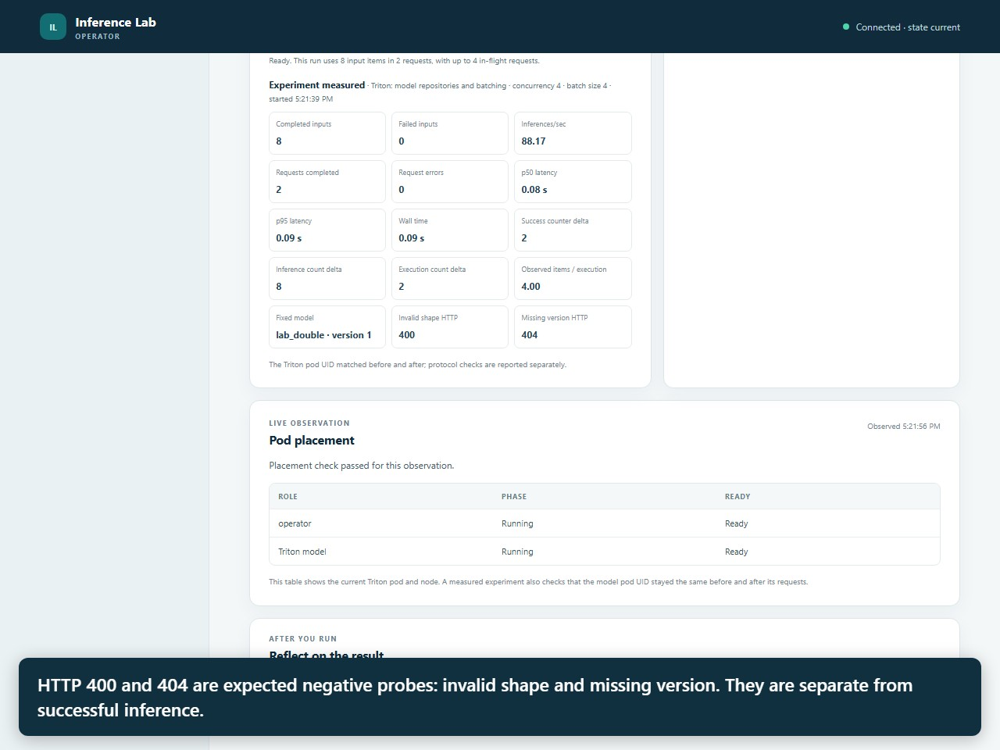
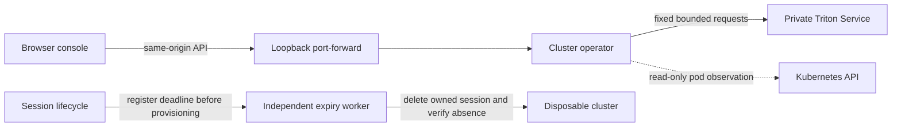

# GPU Inference Scheduling Lab

A hands-on lab for seeing how inference systems place and serve work. Pick a lesson, write a prediction, run a small fixed experiment, then compare the result with live pod observations and service metrics.

## Two-minute refresher

The first two lessons run a real Qwen3-0.6B model with Ray Serve and vLLM on CPU Kubernetes. They explore placement, request routing, throughput and recovery. Lesson 04 follows a separate path: NVIDIA Triton serves a tiny deterministic CPU model that doubles FP32 values. It teaches model versions, tensor shapes, request batching and server metrics; it is not an LLM or GPU benchmark.

In the console, select the server-designated active lesson, read its steps, and record a prediction. For Triton, choose a client batch size and concurrency, run eight input items, and compare completed inputs, HTTP requests and Triton counter deltas. The prediction is kept in the current browser only. Lesson selection does not deploy infrastructure.

The Triton CPU runtime, console API and browser experiment were validated on **2026-11-06**. The walkthrough's disposable session was then shut down, and cluster, VM and boot-disk absence were verified. Historical measurements describe that run; they do not guarantee a live deployment. Slurm remains gated, and GPU execution is future work.

Start here:

- [Quick guide](QUICK_GUIDE.md) — screen-by-screen console walkthrough and how to interpret the Triton run.
- [Triton lesson](lessons/04-triton-cpu-serving/README.md) — model, request examples and runtime constraints.
- [Operator guide](operator/README.md) — console API and localhost access.
- [Session runbook](docs/runbook.md) — reviewed activation and shutdown procedure.
- [Compatibility notes](docs/lesson-compatibility.md) — dated runtime and deployment evidence.

[](videos/triton-batching.webm)

**Watch the 78-second walkthrough:** [video file](videos/triton-batching.webm) · [local player](WATCH.html). Captions explain the real experiment without audio. GitHub may show the player's HTML source; open `WATCH.html` from a downloaded checkout to use the player.

## How the pieces fit

The Triton experiment path is deliberately short: the browser talks to a loopback-forwarded operator, which checks session and lesson state before sending bounded requests to a private Triton Service. The operator reads pod placement from Kubernetes; that observation is separate from the Triton request path. Expiry is registered and handled by the lifecycle service, independently of the browser.



The page enables actions only for the active lesson, a live session, fresh operator state and a Ready model pod. It cannot start, extend or stop a session. Its countdown reflects the last API snapshot; it does not prove that cluster resources have been deleted.

<a id="lessons-and-current-status"></a>

## Lessons and evidence

| Lesson | What it teaches | Evidence status |
| --- | --- | --- |
| [01 · Single-node inference](lessons/01-single-node-inference/README.md) | Baseline inference, concurrency and recovery | Real inference, load and recovery validated |
| [02 · Two-node inference](lessons/02-two-node-inference/README.md) | Independent model copies, placement and survivor behavior | Placement, load and recovery validated through the console API; fresh browser walkthrough remains |
| [03 · Slurm CPU scheduling](lessons/03-slurm-cpu-scheduling/README.md) | Queues, allocations, limits and cancellation | Gated; offline evidence checker only, no live lesson |
| [04 · Triton CPU serving](lessons/04-triton-cpu-serving/README.md) | Model repository, versions, batching and metrics | CPU runtime, console API, browser experiment and session cleanup validated |

Lesson 04 uses eight fixed input items. Batch size 1 makes eight HTTP requests; batch size 4 makes two. Triton inference and execution counters help show whether executions combined items, but counter differences alone do not prove that client batching caused the difference or establish a performance recommendation. Small CPU measurements are noisy; compare runs with other settings held fixed.

The first two lessons use real Qwen3-0.6B inference. See the [baseline report](docs/results/2026-10-22-cpu-baseline.md) for historical load, recovery and expiry evidence. A Ready pod by itself does not establish a successful inference experiment. The first two lessons use 30 GB standard disks; the Triton CPU plan uses a separately reviewed 80 GB standard disk. No GPU is configured.

## Architecture and operations

The original Ray/vLLM path separates three scheduling layers: Kubernetes places pods, Ray Serve routes requests to request-handling replicas, and vLLM schedules model tokens. Each vLLM pod holds a full model copy. Lesson 04 uses Triton instead of Ray and vLLM.

For deeper detail, read the [architecture overview](docs/architecture.md), [experiment notes](docs/experiments.md), and [deployment and shutdown runbook](docs/runbook.md). Run only one lesson per disposable session. Expiry is registered before provisioning and runs independently of the local console; retain the runbook's ownership and cleanup checks.

## Local checks

Use Python 3.12 and kubectl. These checks need no cloud credentials:

```sh
python -m venv .venv
# Activate .venv for your shell.
python -m pip install -e '.[checks,serve]' -r infra/session/requirements.txt
python -m unittest discover -s tests -v
python checks/infra_contract.py -v
python checks/manifests.py
python checks/runtime_contract.py
python checks/adapter_contract.py -v
```

On Linux, `python checks/ray_smoke.py` checks the Ray serving integration against an HTTP fixture; it does not run a language model. Local checks, hosted CI and live model experiments are separate evidence.
