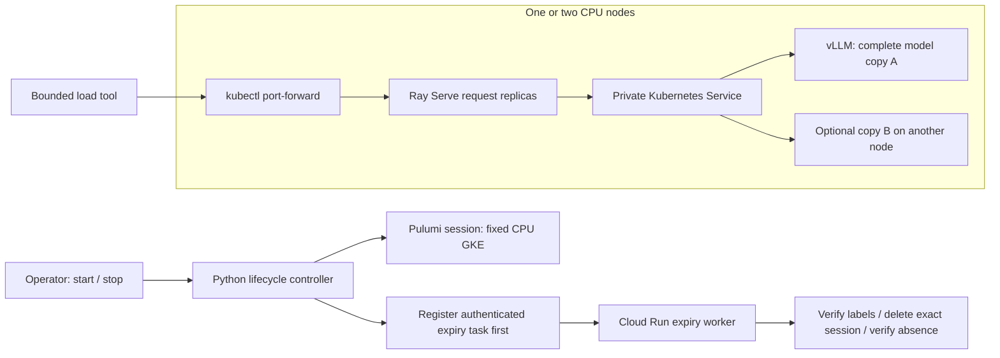

# GPU Inference Scheduling Lab

A hands-on platform for understanding how inference systems behave under load and failure. Run a real language model, observe where its pods and request handlers execute, and compare latency, throughput and recovery through bounded experiments.

The lab starts with **CPU inference on Kubernetes**. Pulumi Python provisions disposable GKE sessions; Ray Serve routes requests to vLLM model servers. A cluster-hosted operator console brings lesson instructions, live placement, readiness, measurements and session lifetime into one localhost-forwarded page. GPU execution is future work.

## What this project demonstrates

- **Scheduling at different layers:** Kubernetes places pods, Ray places request-handling replicas, and vLLM schedules model tokens.
- **Measured experiments:** fixed prompts and bounded request batches make one-node and two-node behavior comparable.
- **Failure recovery:** pod UIDs and readiness distinguish a replacement from a surviving replica; real generation verifies recovery.
- **Disposable infrastructure:** expiry is registered before provisioning and runs independently of the local client.
- **Constrained operations:** private Services, a read-only pod observer and fixed experiment adapters keep provisioning and arbitrary commands out of the browser.

## Lessons and current status

| Lesson | Focus | Status |
| --- | --- | --- |
| [01 · Single-node inference](lessons/01-single-node-inference/README.md) | Establish a baseline and compare concurrency settings | Real inference, load and recovery validated |
| [02 · Two-node inference](lessons/02-two-node-inference/README.md) | Independent model copies, placement and survivor behavior | Placement, load and recovery validated through the console API |
| [03 · Slurm CPU scheduling](lessons/03-slurm-cpu-scheduling/README.md) | Queues, allocations, job limits and cancellation | Materials prepared; deployment compatibility gates remain |
| [04 · Triton CPU serving](lessons/04-triton-cpu-serving/README.md) | Model repositories, versions, batching and metrics | Inputs, adapter and console controls prepared; runtime gates remain |

The CPU lessons use real **Qwen3-0.6B** inference. Local checks, container checks and live experiments are recorded separately; healthy pods alone do not establish inference success. The [initial baseline report](docs/results/2026-10-22-cpu-baseline.md) includes measured load, recovery and automatic-expiry evidence. The [compatibility assessment](docs/lesson-compatibility.md) explains the remaining Slurm and Triton decisions.

## Architecture

The diagram shows the CLI request path and session lifecycle. The operator console uses the same private Ray-to-model path and adds read-only Kubernetes pod observations.



Each vLLM pod holds a complete model copy. The Kubernetes Service distributes connections to Ready model pods; this is replica-based serving, not model partitioning. A Ray node header identifies the request handler, not the model pod that generated the response.

The console follows a simple learning loop: **predict → run a bounded experiment → inspect the evidence → explain the result**. Selecting a lesson does not provision its infrastructure. Start with the [lesson guide](lessons/README.md), [operator console guide](operator/README.md), or [architecture overview](docs/architecture.md).

## Run the local checks

Use Python 3.12 and kubectl. These checks do not require cloud credentials.

```sh
python -m venv .venv
# Activate .venv for your shell.
python -m pip install -e '.[checks,serve]' -r infra/session/requirements.txt
python -m unittest discover -s tests -v
python checks/infra_contract.py -v
python checks/manifests.py
python checks/runtime_contract.py
python checks/adapter_contract.py -v
```

On Linux, `python checks/ray_smoke.py` also starts a local Ray cluster against an HTTP fixture. It checks serving integration; it does not run a language model. Dockerfiles and a credentials-free pull-request workflow are included.

## Deploy a disposable session

Follow the [deployment and shutdown runbook](docs/runbook.md). Review project configuration, quotas, runtime image digests and cost before provisioning. The validated CPU shape uses one or two `n2-standard-4` nodes with 30 GB standard boot disks, without GPUs or autoscaling. Run lessons sequentially.

The session deadline starts before provisioning. Automatic expiry deletes the disposable cluster; reusable foundation resources such as the registry and expiry service remain and can incur charges. The browser has no cloud start, extend or stop controls.

## Repository guide

| Path | Purpose |
| --- | --- |
| [`lessons/`](lessons/README.md) | Sequential lesson instructions and experiment inputs |
| [`src/inference_lab/`](src/inference_lab) | Lifecycle, serving, benchmark and console backend code |
| [`operator/`](operator/README.md) | Console frontend and operating guide |
| [`infra/`](infra) | Separate Pulumi foundation and session stacks |
| [`k8s/`](k8s) | Baseline, two-node and optional console manifests |
| [`tests/`](tests) and [`checks/`](checks) | Behavior tests and infrastructure/runtime contracts |

Further reading: [experiment worksheet](docs/experiments.md) and [runtime compatibility and license notes](docs/lesson-compatibility.md).
