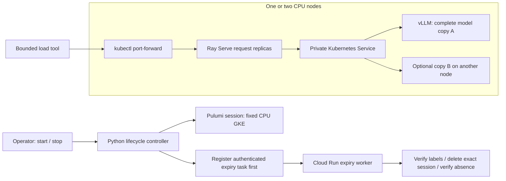

# GPU Inference Scheduling Lab

A CPU-first Kubernetes lab for learning inference infrastructure with GCP credits. Provision with **Pulumi Python**. Run a small model with vLLM, route requests through Ray Serve, and measure what happens under load and failure. GPU hardware, Triton and Slurm are later lessons.

Preparation in progress, October 22, 2026. No cloud resources have been created by this implementation. Offline tests are evidence about code behavior; real model execution, cloud expiry and cost remain activation checks. [Delivery evidence](docs/preparation.md) distinguishes them.



Kubernetes chooses pod placement. Ray chooses where its application replicas run and routes their work. The Kubernetes model Service distributes connections to ready vLLM pods. vLLM schedules tokens and manages the model's cache. These are separate scheduling layers: Ray does not own the vLLM pods or split the model across them.

Start with the [plain-language architecture](docs/architecture.md), [deployment and shutdown runbook](docs/runbook.md), and [experiment worksheet](docs/experiments.md). The [source and license catalog](docs/cpu-poc-plan.md) explains the software choices. Fleet supplied lifecycle design patterns; [reuse provenance](docs/reuse.md) records the boundary.

## Local preparation checks

Python 3.12 and kubectl are required. No GCP credentials are needed for these checks.

```sh
python -m venv .venv
# Activate .venv using your shell.
python -m pip install -e '.[checks,serve]' -r infra/session/requirements.txt
python -m unittest discover -s tests -v
python checks/infra_contract.py -v
python checks/manifests.py
python checks/runtime_contract.py
python checks/adapter_contract.py -v
```

`python checks/ray_smoke.py` additionally starts a local Ray cluster and an HTTP fixture on Linux. It exercises the serving integration, not a language model. Dockerfiles and a credentials-free PR workflow are included. Build the custom Ray image and replace `registry.invalid/inference-lab/ray:review-required` with its reviewed digest before deployment.

## Delivery boundary

The first activation is a one-node baseline, followed by a new two-node session. Each node is `n2-standard-4` with a 30 GB standard disk; no autoscaling or GPUs. Actual schedulability and model/image compatibility must be measured. A deadline starts before provisioning and is limited to four hours. Cluster deletion removes the disposable session; registry storage and other foundation services remain and can incur charges.

Do not run provisioning until the owner reviews current trial entitlement, quotas, CPU compatibility, IAM and the full session cost. Use the [runbook](docs/runbook.md). The [original GPU experiment](docs/experiment-plan.md) and [GPU feasibility gate](docs/feasibility-gate.md) apply to later hardware work. This repository is independent of F0ToFret and Ottawa Fleet Platform.
